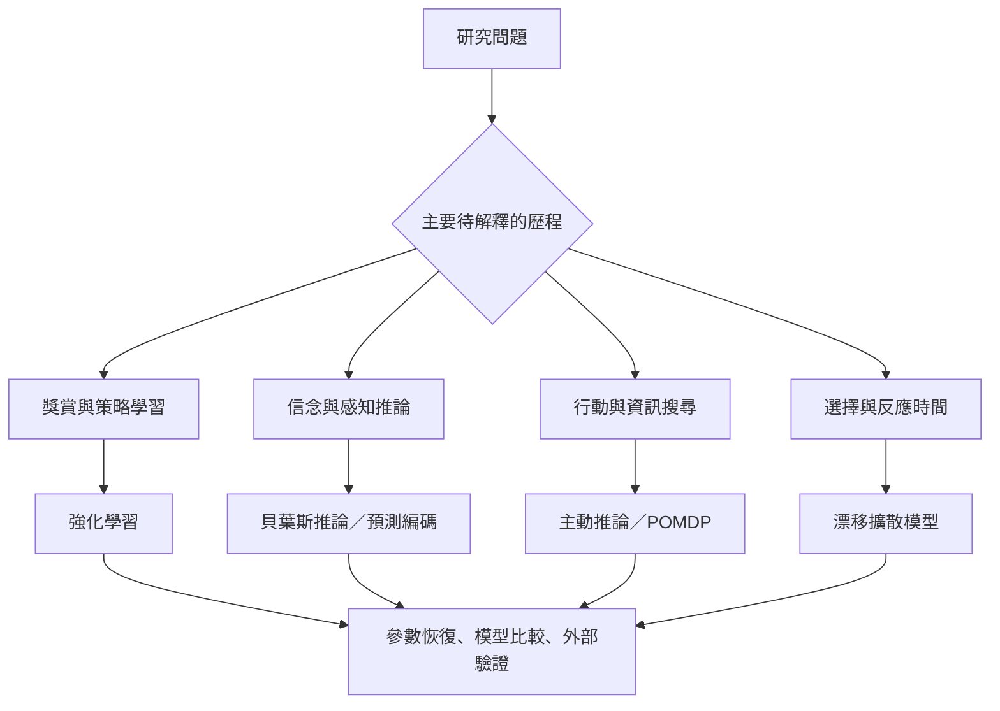

不同模型家族解決不同層次的問題：強化學習描述回饋中的價值更新；貝葉斯與預測編碼描述信念推論；主動推論把推論和行動連接；漂移擴散模型分析證據累積與反應時間；神經迴路模型則嘗試連結計算過程與生物實作。選擇模型應由問題與資料決定，而不是由熱門程度決定。

## 思與行
* 將每個模型的必要假設與可區辨預測寫在同一頁。
* 避免把不同模型輸出的相似名稱參數視為同一心理變項。

## 參考
* [[計算精神醫學入門教材建立跨層次研究地圖]]。
* [[模型式與模型無關強化學習是操作性區分而非人格分類]]；[[主動推論把知覺更新與行動選擇放在同一模型中]]；[[漂移擴散模型 Drift-Diffusion Model]]。
