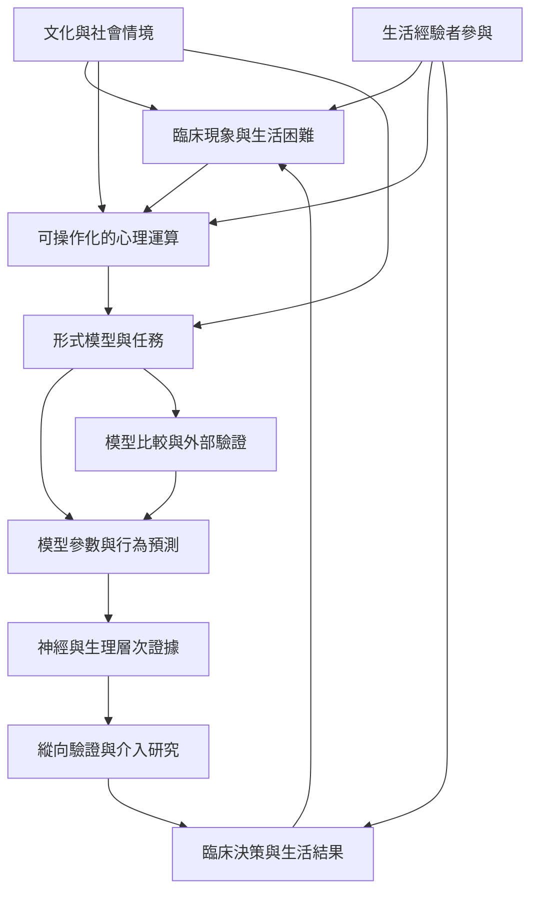

計算精神醫學可視為一條從臨床現象回到心理運算、再連接神經實作與介入的研究路徑。它需要同時處理理論機制、資料模型、測量品質及臨床用途，不能把模型精度直接等同病理解釋。

## 思與行
* 先定位研究位於流程哪一段，再判斷它的證據是否足以支持更下游的主張。
* 使用[[機制導向模型與資料導向模型必須使用不同的臨床評估標準]]區分研究目的。

## 參考
* [[計算精神醫學嘗試連接神經機制與臨床問題]]。
* [[計算精神醫學的模型應明確指出它要解釋哪一種心理運算]]；[[模型可計算不代表它已具備臨床效用]]；[[計算精神醫學 Computational Psychiatry]]。
