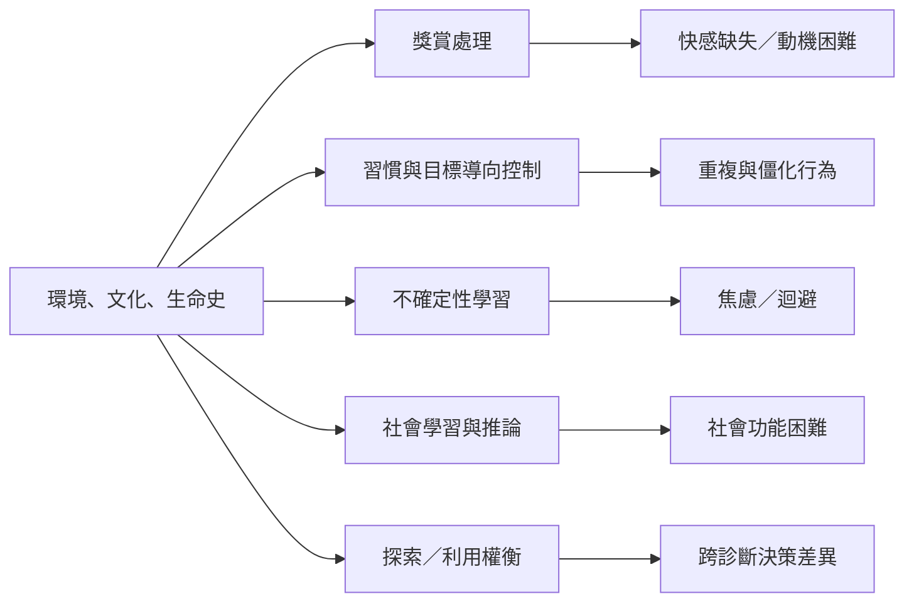

跨診斷研究不等於把所有疾病收進同一理論，而是檢查不同症狀與生活困難是否涉及重疊或不同的心理運算。獎賞學習、習慣、威脅不確定性、社會推論與探索／利用都是候選研究方向，但各領域證據成熟度不一。

## 思與行
* 逐一追蹤不同機制的證據強度，不以單一概念統攝全部症狀。
* 加入個體、情境與縱向資料，避免只比較診斷組別平均值。

## 參考
* [[精神健康研究可以從診斷類別轉向跨診斷功能維度]]。
* [[獎賞學習同時涉及期待、感受、動機與努力成本]]；[[習慣是學習策略與環境結構互動的結果]]；[[不確定性既可能推動探索也可能促發迴避]]；[[社會學習把人際互動拆解成可檢驗的推論過程]]。
