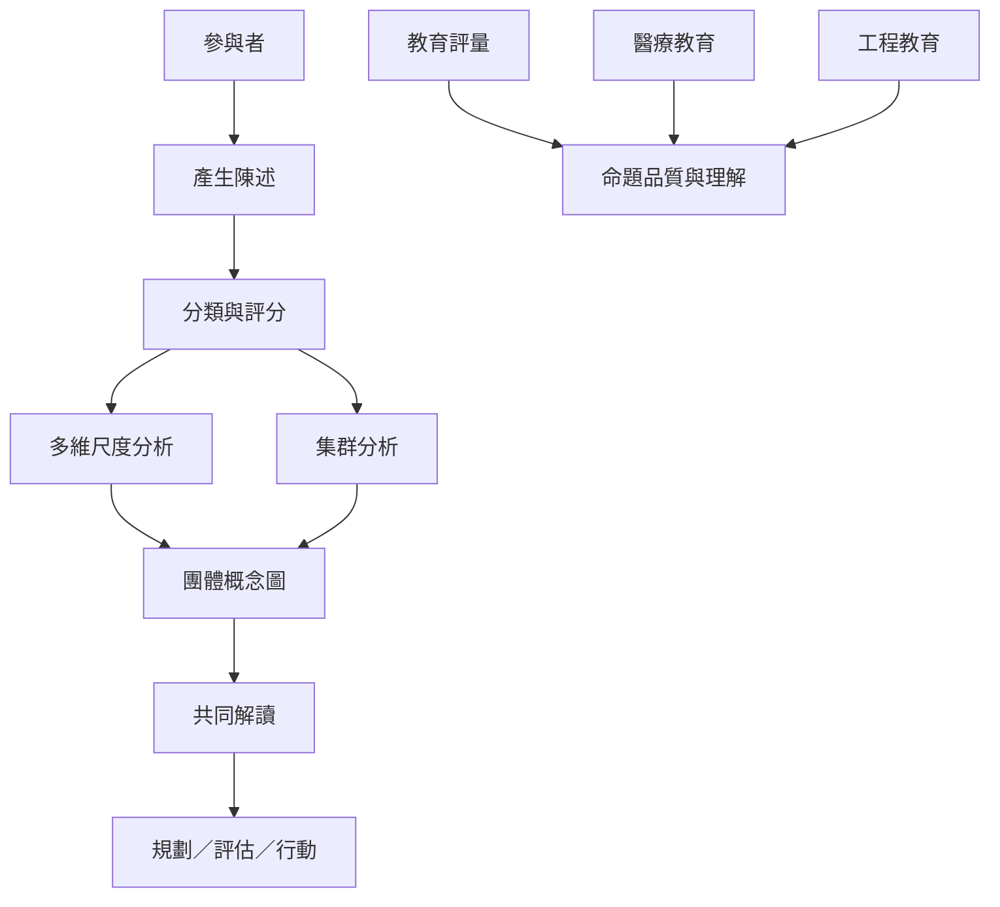

本地圖整理概念圖如何由個人學習工具擴展為團體規劃、教育評量與專業實踐工具。團體概念圖將參與者的語句透過分類、評分與統計分析轉成群體架構；教育與專業場域則需依焦點問題、成果指標與評分規準調整方法。

主要概念：[[團體概念圖]]、[[多維尺度分析]]、[[集群分析]]、[[焦點問題]]、[[概念圖]]。

延伸：[[團體概念圖能使參與者語言成為規劃資料]]、[[概念圖評量應同時看命題品質與知識演變]]、[[概念圖不能取代證據與因果識別]]。
