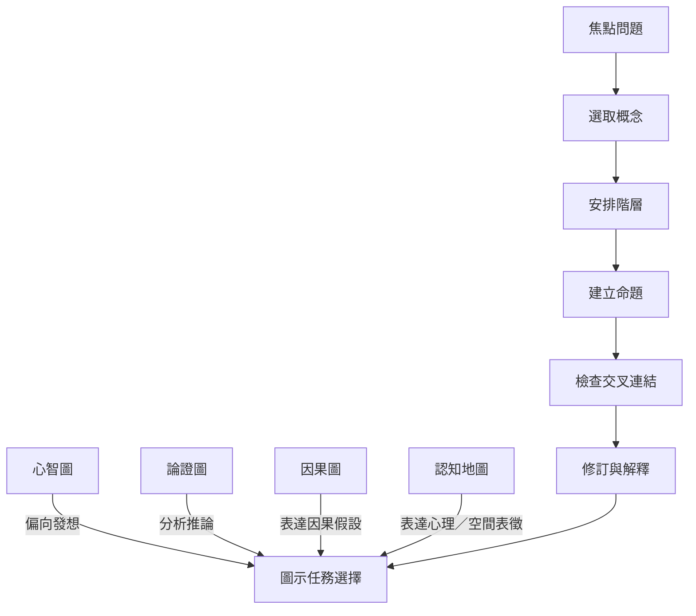

本地圖聚焦概念圖如何形成：由焦點問題界定範圍，選出概念並依一般性安排層級，以連結詞構成命題，再透過交叉連結修訂。它同時區分概念圖與心智圖、論證圖、認知地圖及因果圖，避免因外觀相似而混淆用途。

主要概念：[[概念圖]]、[[焦點問題]]、[[階層結構]]、[[連結詞]]、[[命題]]、[[交叉連結]]、[[心智圖]]、[[論證圖]]、[[認知地圖]]、[[因果圖]]。

延伸：[[概念圖應以焦點問題界定知識範圍]]、[[交叉連結能揭露不同知識群集之間的整合]]、[[圖示方法必須按用途選擇而非混為一談]]。
