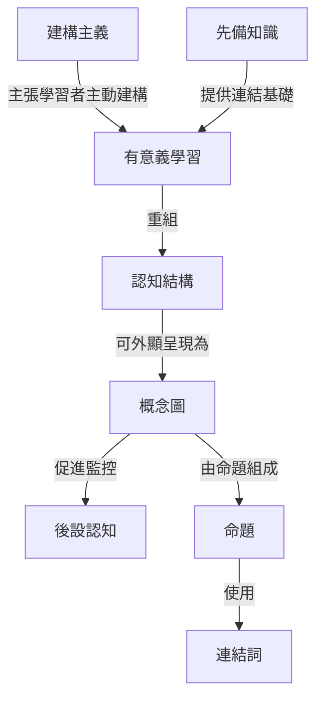

本地圖整理概念圖背後的學習觀：學習者如何以先備知識吸收新知、透過命題重新組織認知結構，並藉由建圖活動監控自身理解。概念圖是一種外顯表徵，不等同於心智本身；其價值在於讓理解可以被討論與修正。

主要概念：[[概念圖]]、[[有意義學習]]、[[先備知識]]、[[認知結構]]、[[建構主義]]、[[後設認知]]、[[命題]]、[[概念]]。

延伸：[[有意義學習始於把新知接回先備知識]]、[[建圖與讀圖是不同的認知活動]]、[[概念圖的價值在於把關係而非清單表達成可檢視命題]]。
