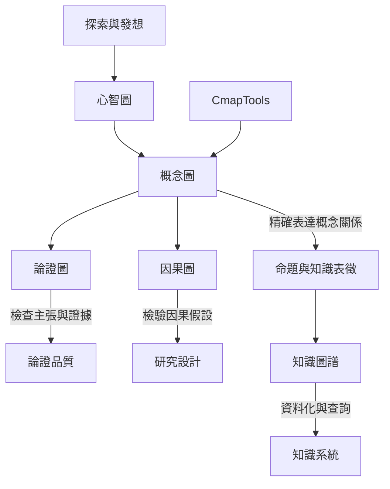

本地圖將概念圖放在更大的知識組織脈絡中。概念圖以人類可讀的命題來展示理解；心智圖負責發想；論證圖拆解推論；因果圖表達因果假設；知識圖譜則以結構化資料支援查詢與運算。它們可以串接成一條從探索、釐清到資料化的工作流。

主要概念：[[概念圖]]、[[心智圖]]、[[論證圖]]、[[因果圖]]、[[知識表徵]]、[[知識圖譜]]、[[CmapTools]]。

延伸：[[知識圖譜與概念圖可互補但解決的問題不同]]、[[數位概念圖的共享優勢不應遮蔽工具成本]]、[[把概念圖作為跨學科知識庫的導航介面]]。
