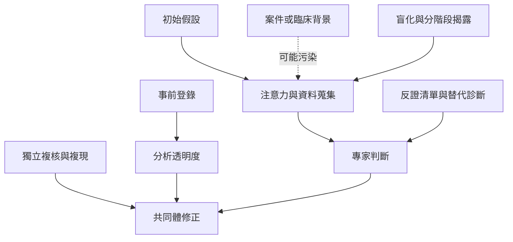

此地圖將個人專業判斷與制度性控制連在一起。醫療與司法鑑識顯示，專家仍可能受到初始假設與背景脈絡影響；科學研究方法則以事前登錄、透明分析、複現與獨立審查，降低事後選擇有利證據的空間。

核心閱讀：[[臨床決策應保留替代診斷與反證檢查]]、[[專家知識無法自動消除情境偏誤]]、[[事前登錄讓研究者在看到結果前公開分析承諾]]。

延伸概念：[[情境偏誤 Contextual bias]]、[[可證偽性 Falsifiability]]、[[事前登錄 Preregistration]]、[[確認偏誤 Confirmation bias]]、[[認識論謙遜 Epistemic humility]]。
