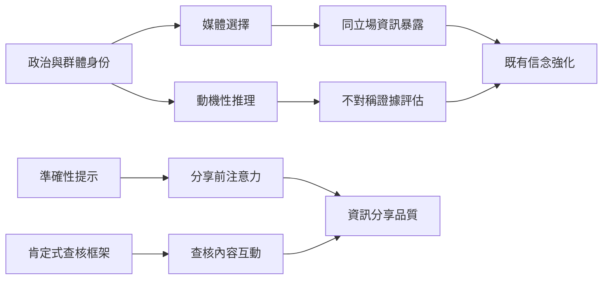

此地圖連結政治立場、身份、媒體選擇與錯誤資訊。研究顯示，資訊選擇與證據評估可能同時受既有態度影響；但分享、互動、相信與理解必須分開測量。跨國研究亦呈現不同溝通框架可能改變受眾接觸查核內容的意願。

核心閱讀：[[政治信念會改變人們評估論證的方式]]、[[選擇性接觸讓資訊環境逐漸貼近既有立場]]、[[分享假訊息不必然表示相信它]]。

延伸概念：[[動機性推理 Motivated reasoning]]、[[身份保護性認知 Identity-protective cognition]]、[[同溫層 Echo chamber]]、[[準確性提示 Accuracy prompt]]、[[持續影響效應 Continued influence effect]]、[[媒體素養 Media literacy]]。
