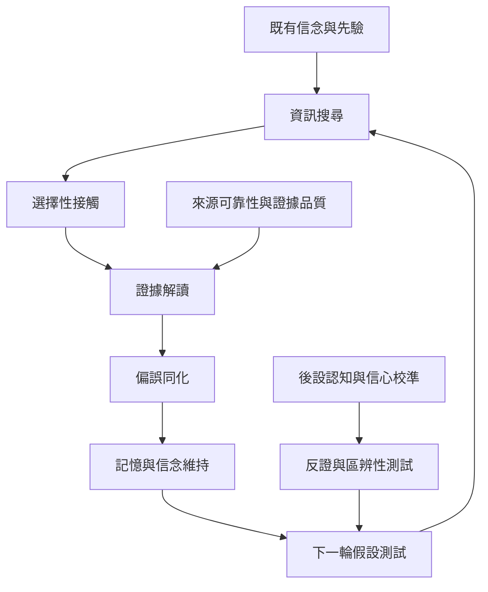

本概念地圖整理確認偏誤的心理流程、相鄰概念與重要理論辨析。核心問題不是「人會不會找支持證據」，而是搜尋與評估規則是否因結論方向而不對稱，以及測試能否區分競爭假設。

核心閱讀：[[確認偏誤會在搜尋解讀記憶與假設測試等不同階段出現]]、[[正向測試策略不等同於確認偏誤]]、[[合理的先驗更新與確認偏誤不能只靠結論是否改變來區分]]。

延伸概念：[[確認偏誤 Confirmation bias]]、[[動機性推理 Motivated reasoning]]、[[選擇性接觸 Selective exposure]]、[[偏誤同化 Biased assimilation]]、[[信念固著 Belief perseverance]]、[[假設檢驗 Hypothesis testing]]、[[反證 Disconfirmation]]、[[正向測試策略 Positive test strategy]]、[[貝氏更新 Bayesian updating]]。
