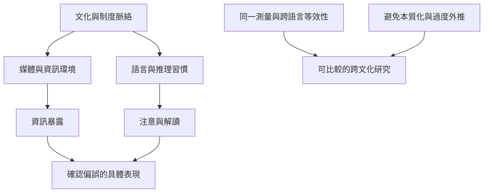

確認偏誤的研究不能只以單一國家或樣本作普遍化。文化、制度、語言與媒體環境可能影響注意與信任；但文化研究的群體差異，不足以推出某一民族天生更容易偏誤。應優先比較直接測量同一心理機制的研究，並檢查翻譯、樣本與測量等效性。

案例包括日本選舉期間的跨國選擇性接觸比較、中國社群媒體使用者實驗、台灣政黨認同與查核效果研究、印度媒體素養實地實驗、阿根廷／巴西／智利／哥倫比亞查核框架實驗、法國新聞選擇研究，以及肯亞和奈及利亞的錯誤資訊介入。東亞與西方認知風格綜述仍只是背景理論，不是確認偏誤的直接跨文化比較。

延伸概念：[[跨國直接比較顯示確認偏誤程度會隨媒體信任與情境改變]]、[[資訊判斷需要把相信分享與情緒反應分開測量]]、[[在地化的提問介入可能比抽象媒體素養訓練更容易融入日常]]、[[文化脈絡可能改變偏誤的表現但不能被本質化]]、[[確認偏誤研究需要區分文化背景與直接測量]]、[[認識論謙遜 Epistemic humility]]。
