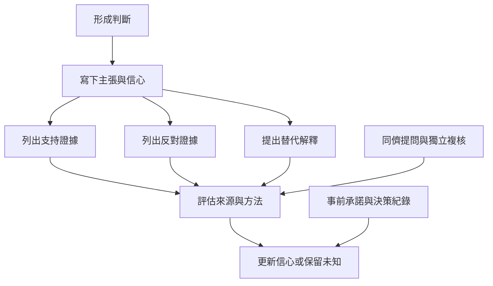

去偏誤的重點是可執行的程序：提出可推翻自己的觀察、考慮相反可能、分開記錄支持與反對證據、校準信心、在分享前注意準確性，以及建立能安全提出異議的共同體。個人策略與制度設計必須並行。

核心閱讀：[[刻意生成反方解釋比宣稱自己客觀更可操作]]、[[把判斷程序外部化比依賴意志力可靠]]、[[集體討論要讓反對意見成為資訊而不是身份威脅]]。

延伸概念：[[認知反思 Cognitive reflection]]、[[後設認知 Metacognition]]、[[認識論謙遜 Epistemic humility]]、[[準確性提示 Accuracy prompt]]、[[反證 Disconfirmation]]。
