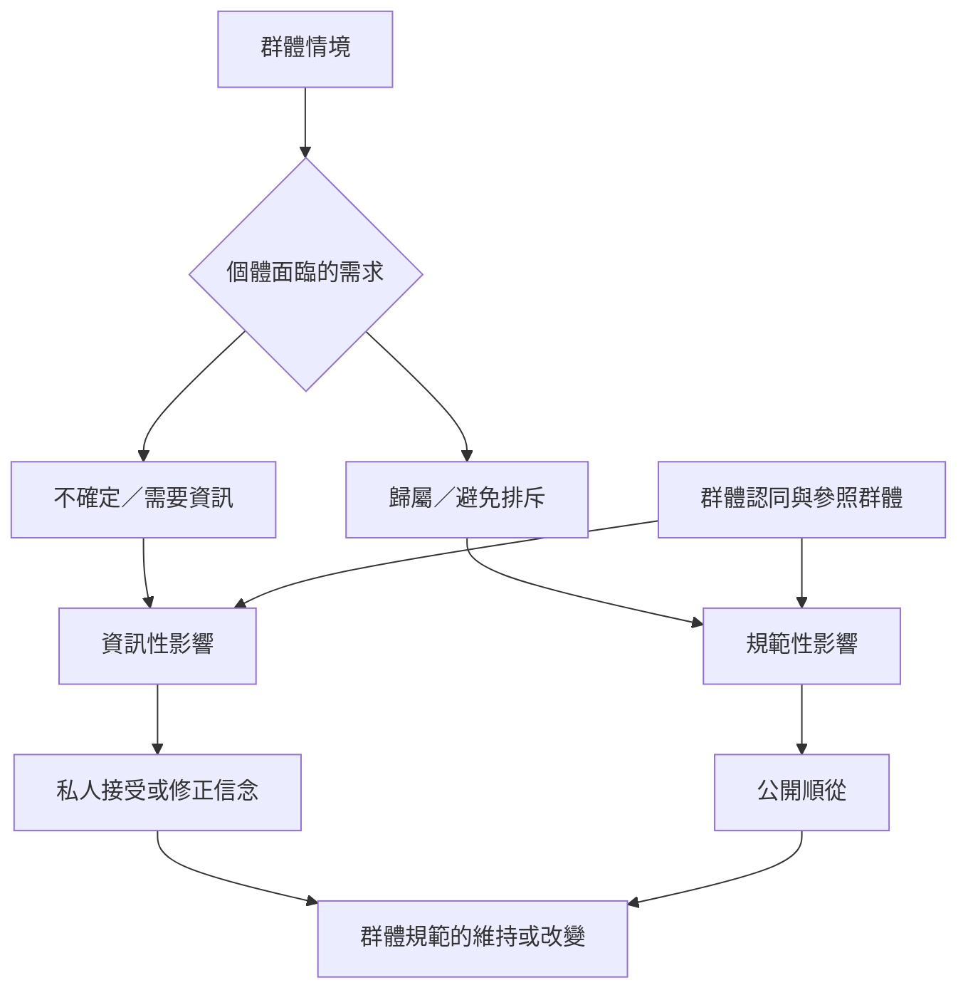

從眾並非一種單一動機，而是資訊需求、關係需求、群體認同與社會期待交織的結果。此圖從影響來源追到公開與私人結果。

概念連結：[[從眾]]、[[社會影響]]、[[規範性影響]]、[[資訊性影響]]、[[公開順從]]、[[私人接受]]、[[社會認同]]、[[參照群體]]、[[社會規範]]。

延伸閱讀：[[從眾是群體影響下的態度或行為調整而非單一人格特質]]、[[少數者持續提出異議能擴張群體可思考的範圍]]、[[改變有害規範必須同時處理期待權力與物質條件]]。
