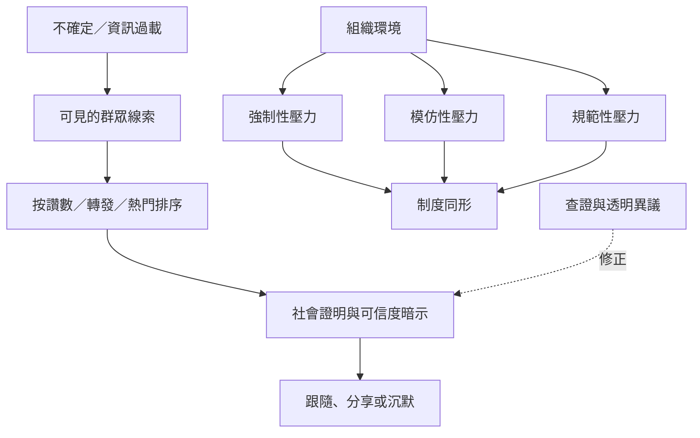

從眾不只發生於面對面互動，也存在平台人氣指標與組織制度趨同中；可見性、權威與不確定性會改變影響路徑。

概念連結：[[社會證明]]、[[制度同形]]、[[描述性規範]]、[[命令性規範]]、[[資訊性影響]]、[[規範性影響]]、[[心理抗拒]]。

延伸閱讀：[[從眾是群體影響下的態度或行為調整而非單一人格特質]]、[[少數者持續提出異議能擴張群體可思考的範圍]]、[[改變有害規範必須同時處理期待權力與物質條件]]。
