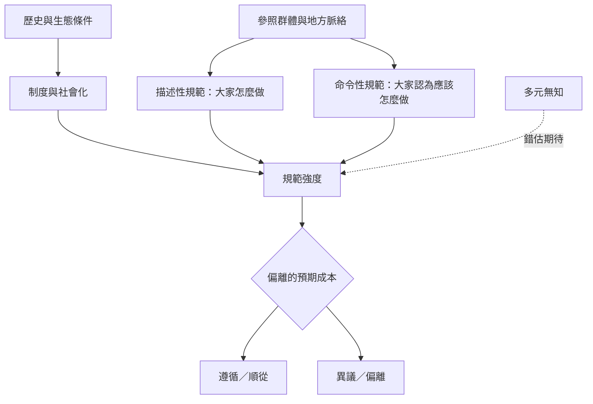

文化比較要避免把國家平均數當作個人特質；規範強度、制度、危機、參照群體與互動情境會共同改變偏離成本。

概念連結：[[社會規範]]、[[描述性規範]]、[[命令性規範]]、[[緊密與寬鬆文化]]、[[多元無知]]、[[從眾]]、[[參照群體]]。

延伸閱讀：[[從眾是群體影響下的態度或行為調整而非單一人格特質]]、[[少數者持續提出異議能擴張群體可思考的範圍]]、[[改變有害規範必須同時處理期待權力與物質條件]]。
