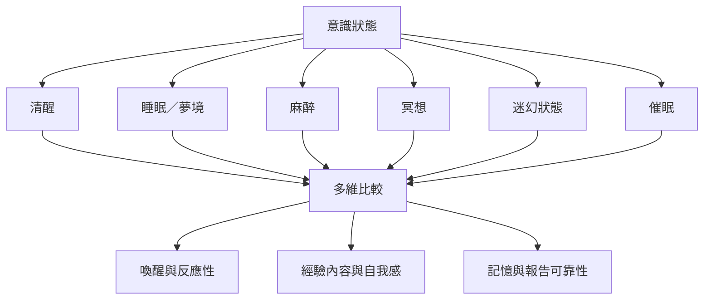

本圖以喚醒、反應性、經驗內容、自我感、記憶與報告可靠性比較清醒、睡眠、麻醉、冥想、迷幻與清醒夢。沒有任何單一維度能完整代表意識。

索引連結：[[意識狀態]]、[[喚醒]]、[[睡眠]]、[[清醒夢]]、[[麻醉]]、[[冥想]]、[[迷幻狀態]]、[[意識狀態研究應把睡眠麻醉冥想與迷幻經驗作維度比較]]、[[生理喚醒不等於主觀意識]]、[[清醒夢使睡眠中的主觀覺察能被部分即時驗證]]。

本書導讀：[[Consciousness_science]]。
