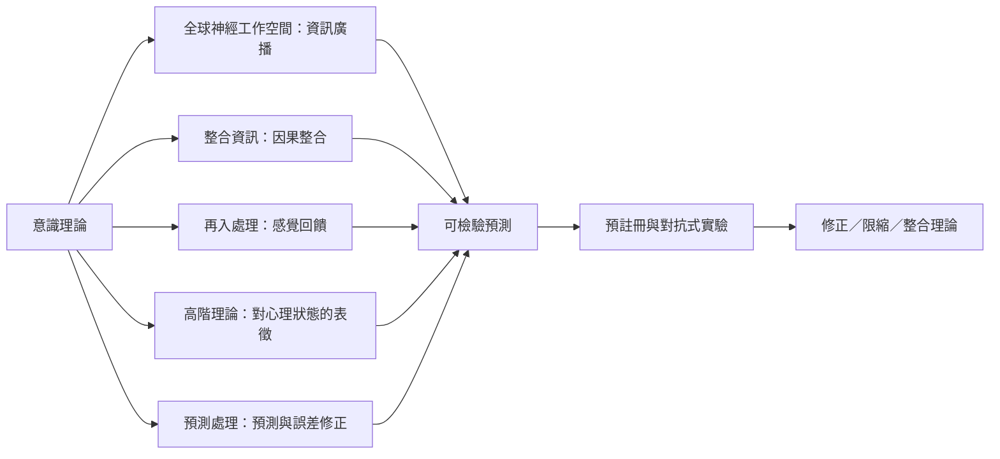

本圖把常見理論放在其主要解釋焦點上。理論之間存在競爭，也可能處理不同層次；公平比較的關鍵是先把各自的經驗定義與可區別預測說清楚。

索引連結：[[全球神經工作空間理論]]、[[整合資訊理論]]、[[再入處理理論]]、[[高階理論]]、[[預測處理]]、[[注意圖式理論]]、[[意識的困難問題]]、[[意識理論需要指出彼此不同的可檢驗預測]]、[[意識科學的理論應按解釋層次而非人氣排序]]、[[2025年跨理論預註冊實驗讓意識理論必須接受共同檢驗]]。

本書導讀：[[Consciousness_science]]。
