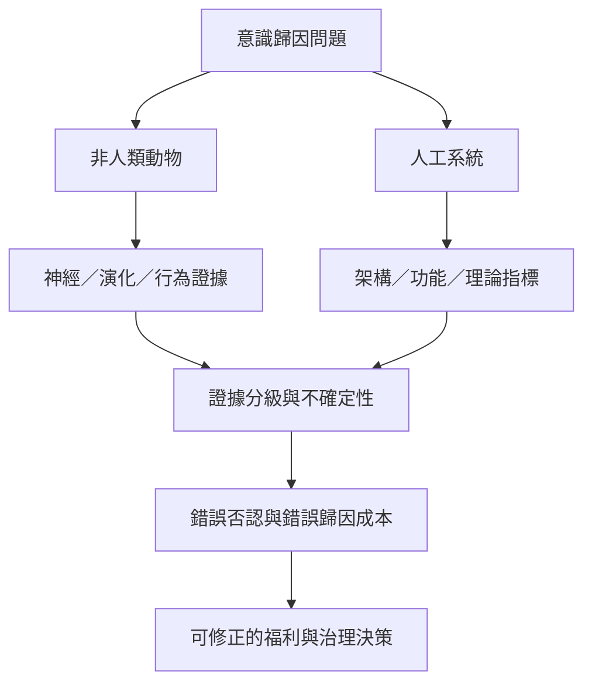

跨物種與人工系統的意識判斷，都需要多重指標與可修正的證據分級，但兩者的生物基礎與測量條件差異很大。動物研究強調演化、神經與福利證據；AI 研究則需從理論推導系統架構指標，不能以擬人表現直接定論。

索引連結：[[動物意識]]、[[機器意識]]、[[意識測試]]、[[感受能力]]、[[倫理上的預防原則]]、[[動物意識研究應採取審慎的預防原則]]、[[人工系統的意識判斷應從理論指標而非語言表現出發]]、[[意識與智能不能直接畫上等號]]、[[意識研究的倫理不確定性要求避免過早排除]]。

本書導讀：[[Consciousness_science]]。
