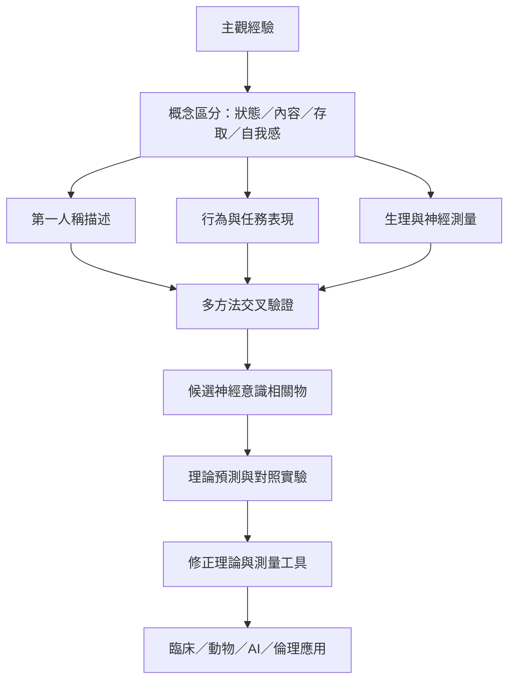

本圖整理意識科學的核心研究流程：先區分狀態、內容、存取與自我感，再以第一人稱描述、行為與生理／神經測量建立證據，最後透過理論預測與實驗比較逐步修正模型。

索引連結：[[意識]]、[[現象意識]]、[[存取意識]]、[[神經意識相關物]]、[[意識測試]]、[[第一人稱方法]]、[[現象學]]、[[無報告範式]]、[[後設認知]]、[[意識研究必須把經驗狀態內容與自我感分開]]、[[主觀經驗是第一人稱事實但需要第三人稱方法交叉檢查]]、[[意識的神經相關物不等於意識的完整解釋]]、[[意識的報告能力與主觀經驗必須分開評估]]、[[生理喚醒不等於主觀意識]]。

本書導讀：[[Consciousness_science]]。
