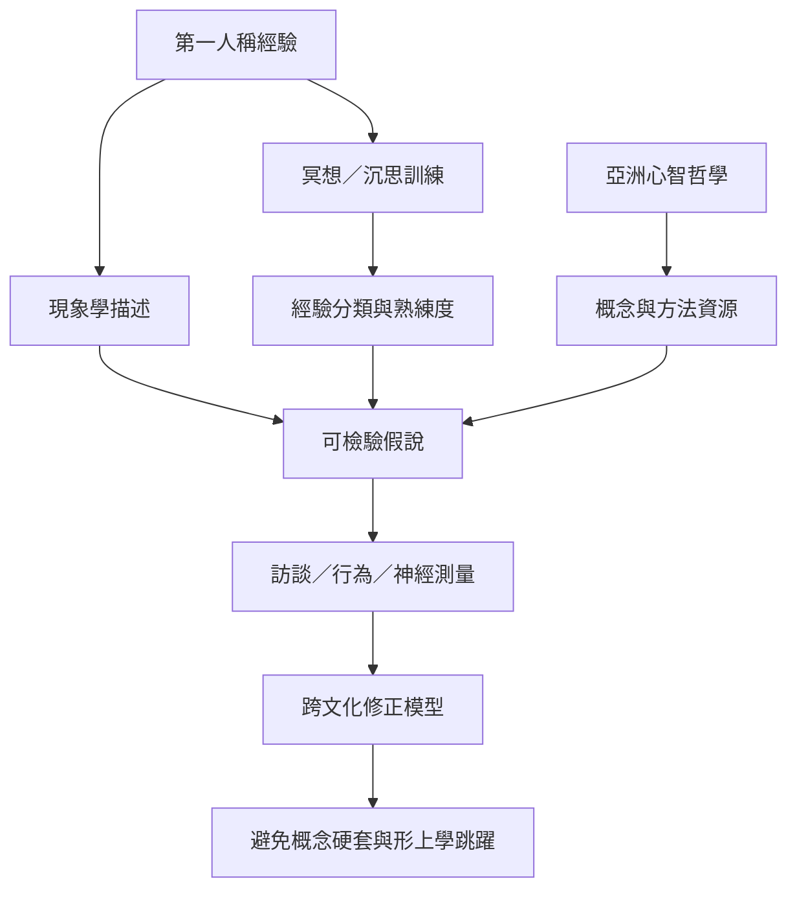

冥想、現象學與亞洲心智哲學能提供更細緻的經驗分類，成為假說形成與第一人稱方法的資源。研究需避免把傳統教義直接等同神經機制，也要保留修行技術、語言與倫理脈絡。

索引連結：[[冥想]]、[[現象學]]、[[第一人稱方法]]、[[無我]]、[[自我感]]、[[印度佛教心智理論提醒意識不必預設固定自我]]、[[沉思傳統可提供假說但不能取代科學驗證]]、[[跨文化比較應翻譯問題而非把詞語硬套成同義詞]]、[[沉思訓練能擴大第一人稱資料的解析度]]。

本書導讀：[[Consciousness_science]]。
