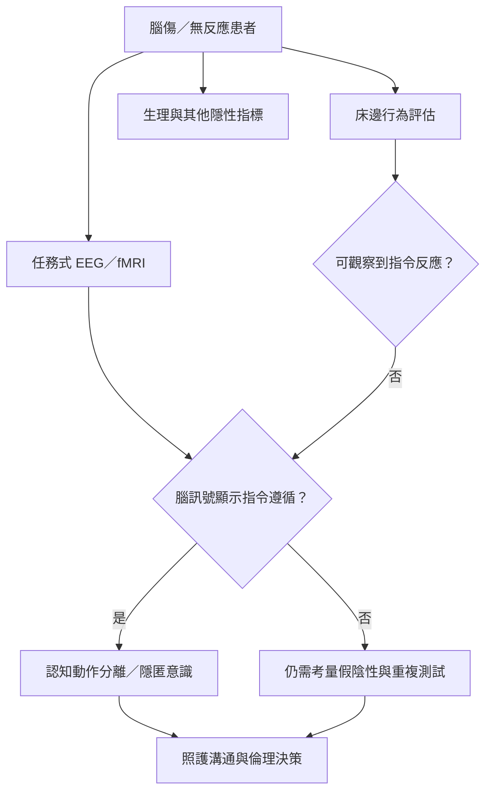

臨床意識評估必須區分外顯行為與內在認知。任務式 EEG／fMRI、隱性生理指標與反覆行為評估能互補，尤其有助於辨識認知動作分離與隱匿意識；陰性結果仍需考量測試能力與病況波動。

索引連結：[[隱匿意識]]、[[認知動作分離]]、[[意識障礙]]、[[意識測試]]、[[意識的報告能力與主觀經驗必須分開評估]]、[[無反應不代表沒有理解能力或主觀經驗]]、[[生理訊號有機會在無法言語回報時協助推論意識]]。

本書導讀：[[Consciousness_science]]。
