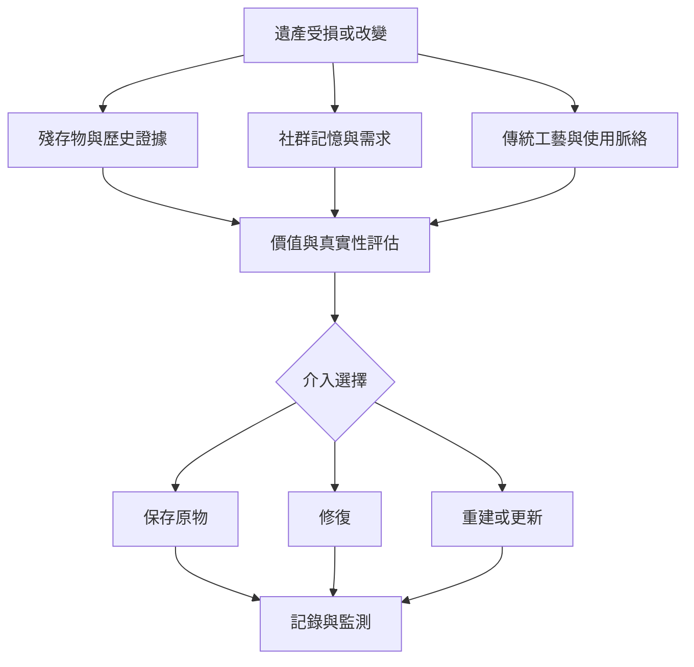

重建的關鍵並非單純複製外觀，而是判斷哪些文化價值能以何種方式延續。奈良文件、伊勢神宮、尼泊爾與廷巴克圖案例共同提示：材料、工法、儀式、用途、場所及社群認可都可能是判斷依據，但每一案例都必須回到自身脈絡。

雙向連結：[[真實性]]、[[重建]]、[[傳統工藝]]、[[文化意義]]、[[修復不是把建築帶回單一原點而是公開選擇歷史層次]]、[[重建的正當性來自證據透明和社群認可而非外觀相似]]。
