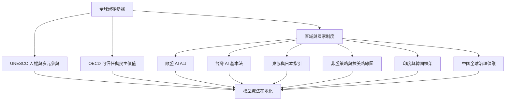

各地治理框架與 CAI 的技術方法不是同一層次：模型憲法規範模型行為，國際建議、國家法律與區域指南則規範組織與公共制度。比較它們可以找出共同底線，也能看見不同地區對發展、權利、安全、文化與主權的排序差異。

核心連結：[[人權導向 AI 治理]]、[[民主正當性]]、[[價值多元主義]]、[[全生命週期治理]]。

相關卡片：[[UNESCO 倫理建議將人權多元參與與問責納入 AI 全生命週期]]、[[台灣人工智慧基本法以七項原則建立人本 AI 框架]]、[[非盟大陸 AI 策略主張在地優先與包容發展]]、[[拉美加勒比路線圖把 AI 倫理由原則推進至區域實施]]。

回到 [[Constitutional_ai]]。
