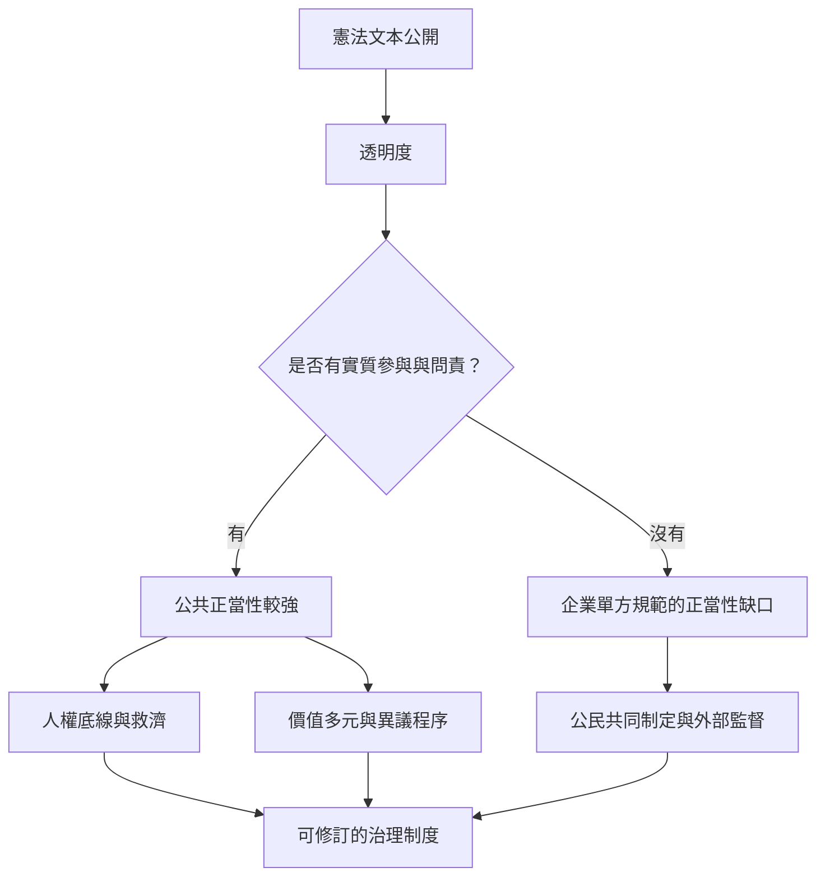

憲法式 AI 的核心難題不只在模型能否學會原則，也在原則由誰制定、代表誰、如何處理價值衝突，以及誰對結果負責。這張地圖將模型憲章與憲政主義、民主正當性、人權、價值多元和公共參與連接起來。

核心連結：[[憲政主義]]、[[民主正當性]]、[[價值多元主義]]、[[公民參與]]、[[人權導向 AI 治理]]。

相關卡片：[[透明公開不等於民主正當性]]、[[AI 憲法必須把具體人權與救濟程序寫清楚]]、[[AI 憲法不應以擬人化取代制度責任]]。

回到 [[Constitutional_ai]]。
