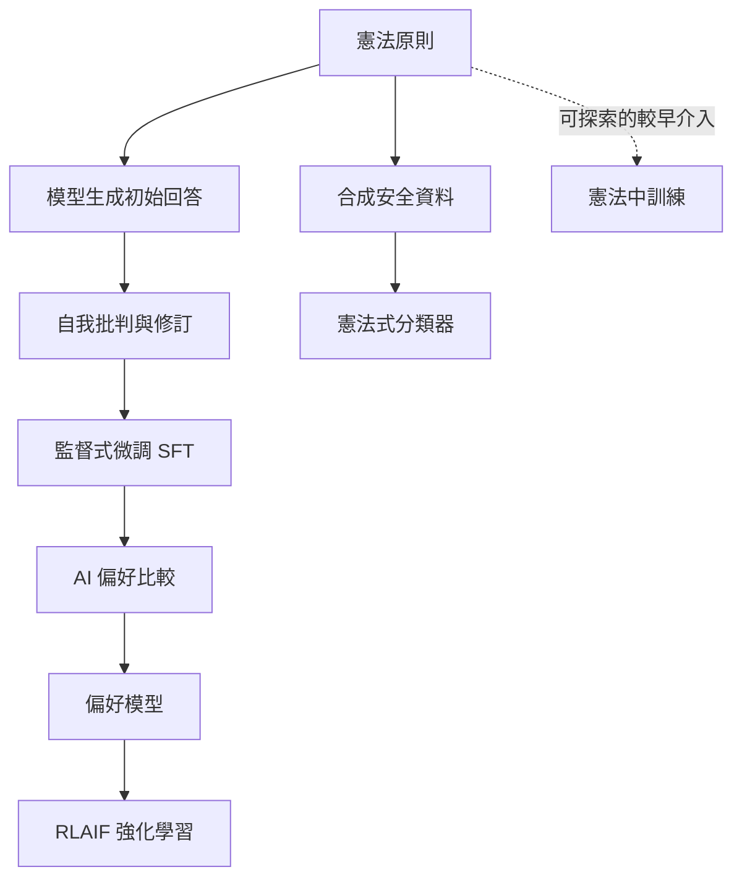

CAI 訓練可視為把自然語言原則逐步轉為模型可學習的行為訊號。這張地圖連接憲法文本、自我批判、示範資料、偏好模型、強化學習，以及較新的中訓練與安全分類器研究。它描述方法關係，不代表所有 CAI 實作都採取完全相同的架構。

核心連結：[[憲法式 AI]]、[[監督式微調]]、[[自我批判與修訂]]、[[偏好模型]]、[[AI 回饋強化學習]]、[[可修正性]]。

相關研究：[[憲法式 AI 以原則引導模型自我批判與修訂]]、[[RLAIF 以 AI 偏好比較降低有害輸出的人工標註需求]]、[[牛津初步研究顯示憲法中訓練可能提升對齊持久性]]。

回到 [[Constitutional_ai]]。
