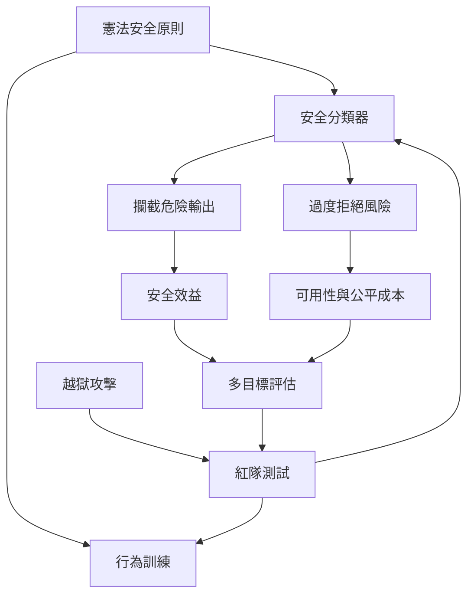

模型安全不是單一的拒絕率問題，而是安全性、可用性、公平性、成本與能力的權衡。這張地圖把憲法原則、越獄攻擊、分類器、紅隊、誤拒與持續評估連在一起。

核心連結：[[越獄攻擊]]、[[過度拒絕]]、[[對抗測試]]、[[全生命週期治理]]。

相關卡片：[[憲法式分類器以憲法生成的合成資料抵禦模型越獄]]、[[憲法式分類器++以分層偵測降低防護成本與誤拒]]、[[安全評估必須同時測量拒絕攻擊與保留正當能力]]。

回到 [[Constitutional_ai]]。
