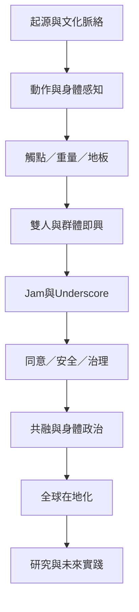

# 《接觸即興：身體、重力、關係與共舞社群》

本書以 Contact Improvisation（接觸即興，簡稱 CI）為主題，從 1972 年美國的早期身體實驗出發，整理其動作原理、感知訓練、教學方法、Jam 社群文化、觸碰倫理，以及在亞洲、歐洲、拉丁美洲等地的在地實踐。它不是單純的舞蹈技巧手冊，而是一份以卡片盒方式組織的研究書庫：每張卡片聚焦一個概念，並透過雙向連結形成可重組的知識網絡。

CI 的核心並非完成一組預設舞步，而是在移動中透過觸點、重力、動量、重量分享與注意力，與另一個身體及周圍環境共同生成動作。從靜止的微小平衡調節，到地板滾動、雙人承重、群體即興，練習者都在處理「如何感知、如何回應、如何協商」的問題。

本書同時保留必要的批判距離：開放式 Jam 不會自動消除性別、階級、種族、身體能力、經驗與權力差異；觸碰可能帶來連結，也可能造成不適或傷害；「自然身體」與「人人都能參加」的宣言，需要由場地可及性、同意制度、社群治理與實際經驗來檢驗。接觸即興的自由，必須與技術、界線、照顧與問責並存。

## 全書地圖

## 建議閱讀路徑

**初學者：先理解形式與身體原理**
1. [[1972年《Magnesium》與紐約演出構成接觸即興的早期起點]]
2. [[接觸即興不是預先編好的舞步而是即時身體對話]]
3. [[觸點會隨時移動使舞者以注意力共同生成下一步]]
4. [[重量分享必須是可調節且可撤回的提議]]
5. [[緩慢的獨舞可以作為接觸即興的基礎練習]]

**實作與教學：進入地板、感知與即興結構**
1. [[地板不只是支撐物而是即興的第三位舞伴]]
2. [[跌倒可以成為重新組織動作的入口而非失敗]]
3. [[身體感知使速度與力道不必完全依賴視覺控制]]
4. [[即興的自由仰賴技術訓練而非排斥結構]]
5. [[Global Underscore讓世界各地同步參與長時段即興結構]]

**社群與倫理：先理解同意，再進入開放舞會**
1. [[社群同意指引將同意視為持續且可撤回的互動流程]]
2. [[同意必須在舞蹈每一刻持續更新]]
3. [[接觸即興中的性別權力會影響參與者能否完整投入]]
4. [[開放即興舞會需要從自我保護走向共同問責]]
5. [[安全不只是個人技巧也取決於社群治理]]

**研究與全球脈絡：從經典民族誌到當代批判**
1. [[《Sharing the Dance》以民族誌呈現接觸即興如何映照美國文化]]
2. [[2014年專題期刊將接觸與即興視為持續協商的關係實踐]]
3. [[2024年五十週年論文集把接觸即興重新放回全球政治脈絡]]
4. [[中國與台灣的接觸即興發展由在地社群共同書寫]]
5. [[印度的接觸即興在跨文化教學與在地社會規範間調整]]
6. [[墨西哥城EPIICO以集體自治與去殖民思考重塑接觸即興]]
7. [[巴西身心障礙舞者的經驗揭示接觸即興包容性的落差]]

## 概念地圖

- [[接觸即興的歷史與核心技術]]：形式、觸點、重量、地板與感知。
- [[觸碰倫理與社群治理]]：同意、性別權力、安全及問責。
- [[全球在地化與權力脈絡]]：中國與台灣、印度、墨西哥、巴西等案例。
- [[身體感知與即興方法]]：本體感覺、動覺、小舞與 Underscore。

## 研究範圍與證據界線

本書優先使用 Contact Quarterly、Oxford University Press、JSTOR、Falmouth University Research Repository、期刊論文、社群公開指引與作者／組織者的一手資料。不同資料類型不能混為一談：歷史檔案可協助重建形式發展；民族誌和訪談能呈現特定社群經驗；理論章節提供批判框架；實驗研究則只支持其研究設計與樣本範圍內的推論。

目前找到的地域材料包含中國與台灣、印度、墨西哥城及巴西的具體章節，並有 Contact Quarterly 對全球傳播的歷史整理；這不代表已完整涵蓋所有國家或非洲各地。不同國家內部也存在多個社群，不能把單一作者或一個城市的經驗概括成整個地區。未來可優先補充非洲、東南亞、日本、韓國、澳洲與其他語言的第一人稱材料。

2025 年一項 48 人的受試者內研究，比較含觸碰與重量分享的 CI 與無接觸舞蹈即興，發現 CI 條件在正向情緒、連結感與自我感受方面有較高變化；兩種條件都降低壓力。這是初步的短期實驗證據，不等於臨床療效或長期結果。任何實踐都不能以研究成果取代個人同意、退出權與安全照顧。

## 延伸實踐

- [[以低重心與地板探索設計友善初學者練習]]
- [[建立一份可以拒絕也可以退出的Jam共識]]
- [[將接觸即興與內觀練習並置但不混為一談]]
- [[用身體地圖記錄觸點重量與情緒變化]]
- [[以三人小組測試旁觀者與支持者角色]]
- [[為台灣在地社群建立多語彙與口述歷史檔案]]
- [[設計可調整速度高度與接觸範圍的共融工作坊]]
- [[將Global Underscore的階段轉化為日常創作觀察框架]]
- [[在共舞活動中實踐互賴而不以融合抹平差異]]

## 全部筆記索引

### 文獻筆記

- [[1972年《Magnesium》與紐約演出構成接觸即興的早期起點]]
- [[2014年專題期刊將接觸與即興視為持續協商的關係實踐]]
- [[2024年五十週年論文集把接觸即興重新放回全球政治脈絡]]
- [[2024年自然身體批判指出中性身體並非真正中立]]
- [[2025年實驗研究初步支持觸碰舞蹈對連結感與正向情緒的影響]]
- [[CI教學書與實作者自述提供不同於民族誌的知識入口]]
- [[Global Underscore讓世界各地同步參與長時段即興結構]]
- [[Videoda檔案保存接觸即興1972至1983年間的影像記錄]]
- [[《Sharing the Dance》以民族誌呈現接觸即興如何映照美國文化]]
- [[中國與台灣的接觸即興發展由在地社群共同書寫]]
- [[印度的接觸即興在跨文化教學與在地社會規範間調整]]
- [[墨西哥城EPIICO以集體自治與去殖民思考重塑接觸即興]]
- [[巴西身心障礙舞者的經驗揭示接觸即興包容性的落差]]
- [[接觸即興中的性別權力會影響參與者能否完整投入]]
- [[接觸即興元素的治療應用必須保留專業界線與同意]]
- [[接觸即興書目與Contact Quarterly構成重要知識檔案]]
- [[接觸即興的宗教功能可作為具身意義探索而非宗教身份]]
- [[接觸即興能作為身體化學習的教學方法但不取代理論討論]]
- [[社群同意指引將同意視為持續且可撤回的互動流程]]
- [[開放即興舞會需要從自我保護走向共同問責]]

### 永久筆記

- [[即興的自由仰賴技術訓練而非排斥結構]]
- [[可及性必須改變環境而非要求身體適應]]
- [[同意必須在舞蹈每一刻持續更新]]
- [[地板不只是支撐物而是即興的第三位舞伴]]
- [[安全不只是個人技巧也取決於社群治理]]
- [[接觸即興不是預先編好的舞步而是即時身體對話]]
- [[緩慢的獨舞可以作為接觸即興的基礎練習]]
- [[自然或中性的身體標準可能複製排除]]
- [[觸碰可能帶來連結但研究結果不等於治療證明]]
- [[觸點會隨時移動使舞者以注意力共同生成下一步]]
- [[跌倒可以成為重新組織動作的入口而非失敗]]
- [[跨文化傳播要求在地翻譯而非輸入單一標準]]
- [[身體即興可以成為政治與社會關係的實驗室]]
- [[身體感知使速度與力道不必完全依賴視覺控制]]
- [[重量分享必須是可調節且可撤回的提議]]
- [[開放舞會的民主承諾不能取代權力分析]]

### 靈感筆記

- [[以三人小組測試旁觀者與支持者角色]]
- [[以低重心與地板探索設計友善初學者練習]]
- [[在共舞活動中實踐互賴而不以融合抹平差異]]
- [[將Global Underscore的階段轉化為日常創作觀察框架]]
- [[將接觸即興與內觀練習並置但不混為一談]]
- [[建立一份可以拒絕也可以退出的Jam共識]]
- [[為台灣在地社群建立多語彙與口述歷史檔案]]
- [[用身體地圖記錄觸點重量與情緒變化]]
- [[設計可調整速度高度與接觸範圍的共融工作坊]]

### 概念筆記

- [[Global Underscore]]
- [[Underscore]]
- [[共融即興]]
- [[動作分數]]
- [[動覺]]
- [[夥伴舞]]
- [[安全勇敢空間]]
- [[小舞]]
- [[持續同意]]
- [[接觸即興]]
- [[接觸即興舞會]]
- [[本體感覺]]
- [[觸點]]
- [[躯體學]]
- [[運動空間]]
- [[重量分享]]

### 概念地圖

- [[全球在地化與權力脈絡]]
- [[接觸即興的歷史與核心技術]]
- [[觸碰倫理與社群治理]]
- [[身體感知與即興方法]]

## 主要延伸書目與資料庫

- [Contact Quarterly：舞蹈、即興與 CI 資源檔案](https://contactquarterly.com/)
- [Resistance and Support: Contact Improvisation @ 50](https://academic.oup.com/book/58815)
- [Sharing the Dance: Contact Improvisation and American Culture](https://www.jstor.org/stable/jj.36032536)
- [Contact Improvisation: Une bibliographie franco-américaine](https://danzaericerca.unibo.it/article/view/6623)
- [Smith College：Contact Improvisation Selected Books](https://libguides.smith.edu/mlacontactimprov/books)
- [Global Underscore](https://globalunderscore.com/about/)

---

本書為持續更新的研究書庫。每張卡片保留其來源、主張範圍與限制；新增經驗時，請區分個人觀察、社群共識與可重複驗證的研究結果。
