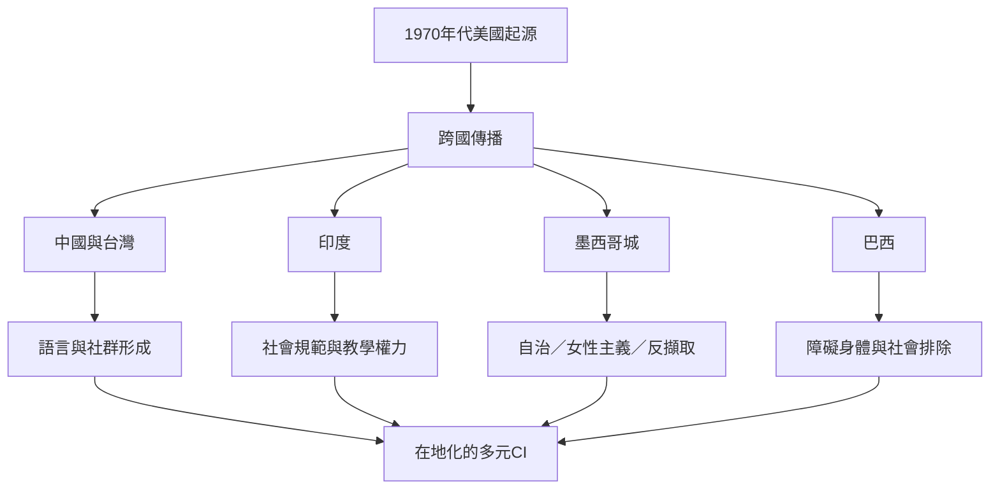

CI 已成為全球流動的舞蹈形式，但地方社群不只是接受一套技術，也會依據語言、經濟、歷史、身體政治與社會規範重新組織實踐。此地圖把不同地域案例放在一起閱讀，但不把單一章節摘要當成整個國家的全貌。

**核心閱讀：** [[中國與台灣的接觸即興發展由在地社群共同書寫]]、[[印度的接觸即興在跨文化教學與在地社會規範間調整]]、[[墨西哥城EPIICO以集體自治與去殖民思考重塑接觸即興]]、[[巴西身心障礙舞者的經驗揭示接觸即興包容性的落差]]、[[2024年自然身體批判指出中性身體並非真正中立]]。

**概念入口：** [[接觸即興]]、[[共融即興]]、[[安全勇敢空間]]。
