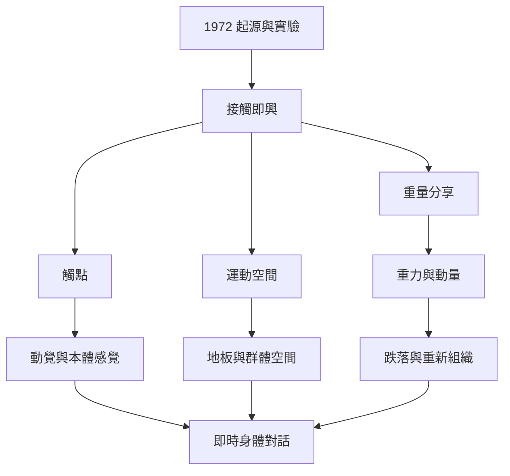

這張概念地圖整理 CI 從 1972 年起源、早期影像與經典民族誌，到觸點、重量分享、地板、跌落與即興技術的關係。閱讀時可先建立形式的歷史位置，再把技術視為感知與安全的組合，而不是動作清單。

**核心閱讀：** [[1972年《Magnesium》與紐約演出構成接觸即興的早期起點]]、[[《Sharing the Dance》以民族誌呈現接觸即興如何映照美國文化]]、[[接觸即興不是預先編好的舞步而是即時身體對話]]、[[重量分享必須是可調節且可撤回的提議]]、[[觸點會隨時移動使舞者以注意力共同生成下一步]]、[[地板不只是支撐物而是即興的第三位舞伴]]、[[跌倒可以成為重新組織動作的入口而非失敗]]、[[即興的自由仰賴技術訓練而非排斥結構]]。

**概念入口：** [[接觸即興]]、[[重量分享]]、[[觸點]]、[[動覺]]、[[本體感覺]]、[[小舞]]、[[運動空間]]、[[夥伴舞]]、[[動作分數]]。
