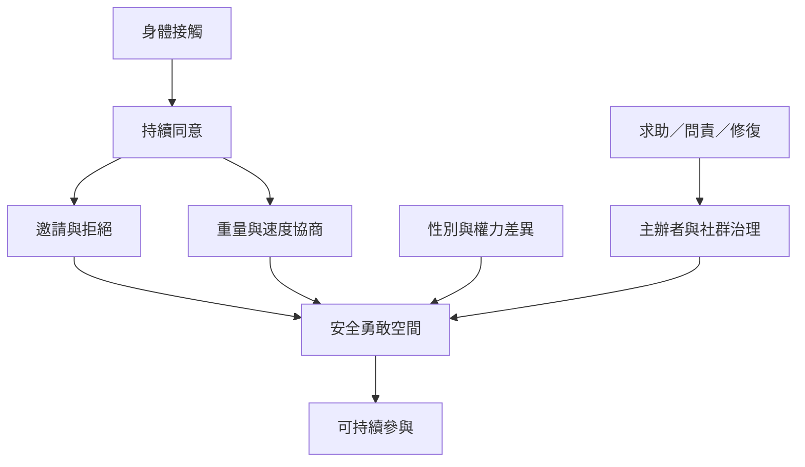

這張地圖將觸碰視為一種需要持續協商的關係實踐。個人技巧、同意、性別權力、場地治理與事件回應彼此相關；任何一層都不能取代其他層。

**核心閱讀：** [[社群同意指引將同意視為持續且可撤回的互動流程]]、[[接觸即興中的性別權力會影響參與者能否完整投入]]、[[開放即興舞會需要從自我保護走向共同問責]]、[[同意必須在舞蹈每一刻持續更新]]、[[安全不只是個人技巧也取決於社群治理]]。

**概念入口：** [[接觸即興舞會]]、[[持續同意]]、[[安全勇敢空間]]、[[共融即興]]。
