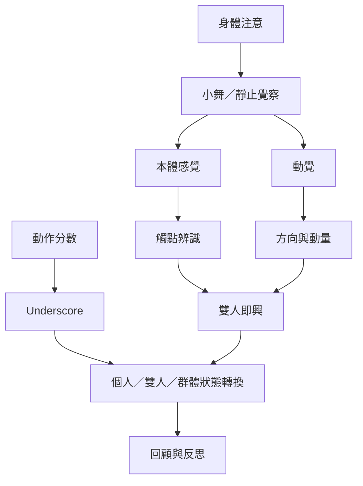

此地圖聚焦 CI 如何運用身體感知、練習分數與反思，把「即興」從任意行動轉成可以學習、討論和持續研究的實踐。Underscore 是一個重要例子，但不是所有 Jam 都採用同一結構。

**核心閱讀：** [[身體感知使速度與力道不必完全依賴視覺控制]]、[[緩慢的獨舞可以作為接觸即興的基礎練習]]、[[Global Underscore讓世界各地同步參與長時段即興結構]]、[[將Global Underscore的階段轉化為日常創作觀察框架]]。

**概念入口：** [[本體感覺]]、[[動覺]]、[[小舞]]、[[躯體學]]、[[動作分數]]、[[Underscore]]。
