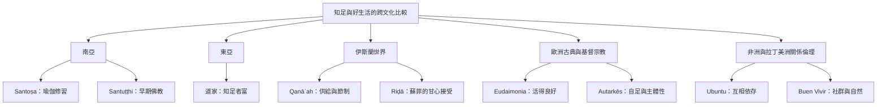

不同文化傳統沒有一個完全等同的「知足」概念。本圖把相近思想並列，顯示它們可能在欲望、接受、修行、共同生活與自然關係上相互啟發，但不可抹平各自的宗教語境與歷史差異。

本圖以比較而非等同為原則。延伸閱讀 [[知足需要與公平和資源分配一起討論]]、[[共同富足不同於個人自足]]、[[接受現況不等於認同現況]]；概念詞條包括 [[桑托沙]]、[[桑圖提]]、[[卡納阿]]、[[里達]]、[[幸福生活]]、[[自足]]、[[烏班圖]] 與 [[美好生活]]。
