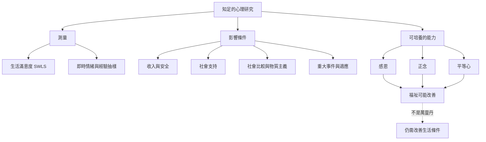

本圖整理可能支持或削弱知足的心理與研究機制：生活評價與情緒需要區分；收入對福祉的關係依測量而異；社會比較與物質主義可能推移足夠標準；感恩、正念與平等心可作為練習，但效果有限且受情境影響。

延伸閱讀 [[收入是生活條件但不存在普世的知足門檻]]、[[知足的標準會被社會比較不斷推移]]、[[感恩可以支持知足但不能取代結構改善]]、[[知足可以由個人練習也需要友善環境支持]] 與 [[知足需要明確定義才能被研究]]。
