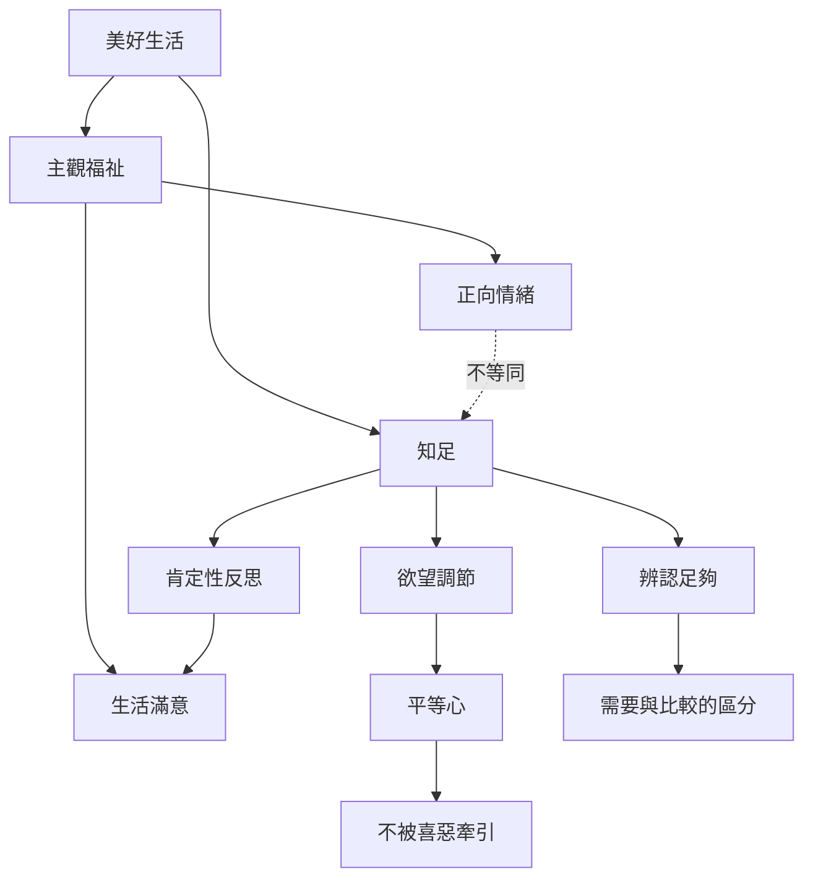

本圖整理知足、快樂、生活滿意、主觀福祉與平等心之間的關係。知足不等同於單一情緒，也不是生活滿意度量表的另一個名稱。研究時需要明確區分測量對象，生活實踐時則可以讓情緒、評價與行動互相校正。

可延伸閱讀 [[知足是一種對生活的肯定性反思]]、[[快樂、生活滿意與知足不能互相替代]]、[[知足需要明確定義才能被研究]]、[[知足的標準會被社會比較不斷推移]] 與 [[平等心讓人不必跟隨每個欲望與排斥]]。
