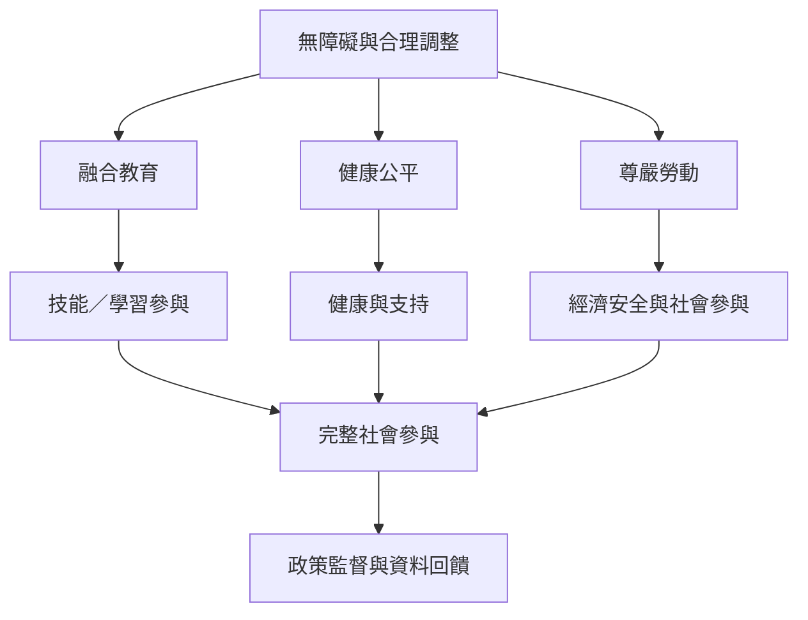

CRPD 把受教權、健康權與工作權視為互相依存的人權。三個領域的共同條件包括可及資訊、合理調整、反歧視、個人選擇與障礙者參與。

## 關係圖

概念連結：[[note/融合教育是教育系統轉型而不是把學生放進普通班|融合教育是教育系統轉型而不是把學生放進普通班]]、[[note/健康公平要求消除醫療體系與社會環境共同造成的障礙|健康公平要求消除醫療體系與社會環境共同造成的障礙]]、[[note/工作權包含公平薪資安全條件與參與集體勞動|工作權包含公平薪資安全條件與參與集體勞動]]、[[note/數位科技必須同時通過可及性與反歧視檢驗|數位科技必須同時通過可及性與反歧視檢驗]]。

回到導讀：[[Convention_on_the_Rights_of_Persons_with_Disabilities|本書導讀]]
