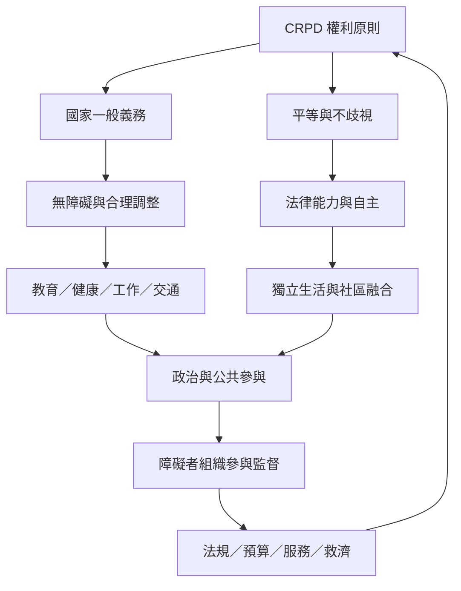

CRPD 的制度結構可以理解為：一般原則與國家義務支撐各項實體權利，執行與監督機制再將權利落實到法規、預算、服務與生活結果。下圖展示的是閱讀架構，不代表條文間只有單向因果。

## 關係圖

概念連結：[[term/身心障礙者權利公約|身心障礙者權利公約]]、[[note/障礙是個人狀況與社會障礙互動後形成的參與限制|障礙是個人狀況與社會障礙互動後形成的參與限制]]、[[note/人權模式把障礙者從福利受助者重新定位為權利主體|人權模式把障礙者從福利受助者重新定位為權利主體]]、[[note/實質平等必須處理不同群體承受的不同障礙|實質平等必須處理不同群體承受的不同障礙]]、[[note/公約落實取決於法律政策預算服務與生活結果的完整鏈條|公約落實取決於法律政策預算服務與生活結果的完整鏈條]]。

回到導讀：[[Convention_on_the_Rights_of_Persons_with_Disabilities|本書導讀]]
