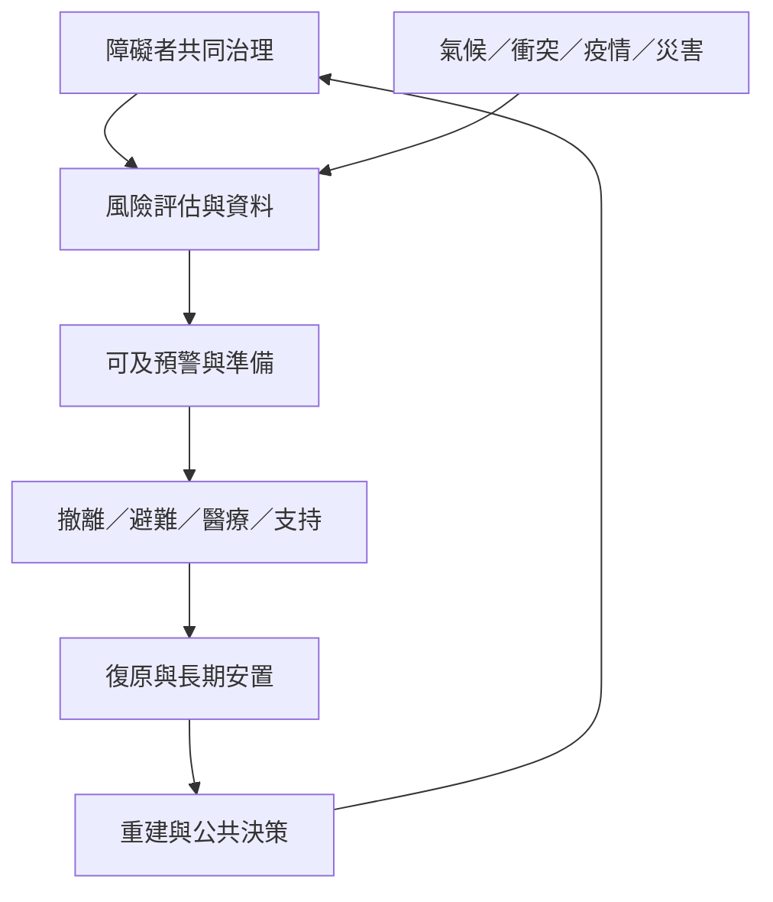

第 11 條提醒國家在危險與人道緊急情況中保障障礙者。風險治理必須貫穿事前資料、預警、準備、應變、避難、復原與重建，而非只在災害發生後臨時提供協助。

## 關係圖

概念連結：[[note/危難與氣候災害會放大既有的障礙與照顧不平等|危難與氣候災害會放大既有的障礙與照顧不平等]]、[[note/危難與氣候災害會放大既有的障礙與照顧不平等|災害治理必須把障礙者納入事前規劃]]、[[data/太平洋障礙者組織把災害風險治理轉向在地共同決策|太平洋障礙者組織把災害風險治理轉向在地共同決策]]、[[data/一般性意見第九號要求國家在危難情境中履行障礙者保護義務|一般性意見第九號要求國家在危難情境中履行障礙者保護義務]]。

回到導讀：[[Convention_on_the_Rights_of_Persons_with_Disabilities|本書導讀]]
