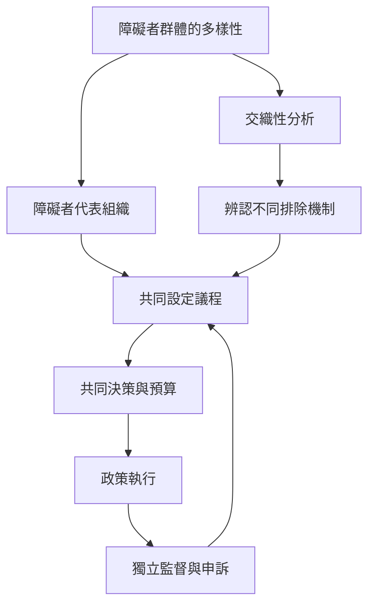

障礙者參與不應停留在提供經驗，而應進入議程設定、政策決策、資源配置與監督。交織性提醒我們，不同障礙者並非單一群體，性別、年齡、族群、語言及地域會改變參與條件。

## 關係圖

概念連結：[[note/障礙者代表組織參與是人權治理而非政策宣傳|障礙者代表組織參與是人權治理而非政策宣傳]]、[[note/實質平等必須處理不同群體承受的不同障礙|實質平等必須處理不同群體承受的不同障礙]]、[[note/障礙女性的權利必須涵蓋身體自主與免於暴力|障礙女性的權利必須涵蓋身體自主與免於暴力]]、[[note/障礙者代表組織是知識生產與政策改革的共同作者|障礙者代表組織是知識生產與政策改革的共同作者]]。

回到導讀：[[Convention_on_the_Rights_of_Persons_with_Disabilities|本書導讀]]
