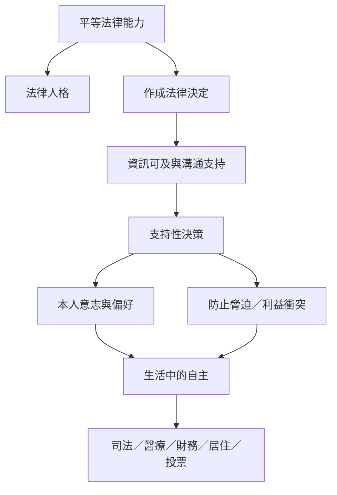

第 12 條的爭議集中在：如何確保每個人都被平等承認為法律主體，同時提供真正尊重本人意願的支持與保障。法律能力改革牽涉醫療、財產、居住、司法與政治參與，不能只限縮為監護法修正。

## 關係圖

概念連結：[[note/法律能力不是心智能力測驗而是平等法律人格與行使權利的地位|法律能力不是心智能力測驗而是平等法律人格與行使權利的地位]]、[[note/支持性決策把自主理解為可由關係與環境支持的能力|支持性決策把自主理解為可由關係與環境支持的能力]]、[[note/自主需要支持而不是替代決策|自主需要支持而不是替代決策]]、[[note/公約落實取決於法律政策預算服務與生活結果的完整鏈條|台灣的監督制度需要跨領域追蹤]]。

回到導讀：[[Convention_on_the_Rights_of_Persons_with_Disabilities|本書導讀]]
