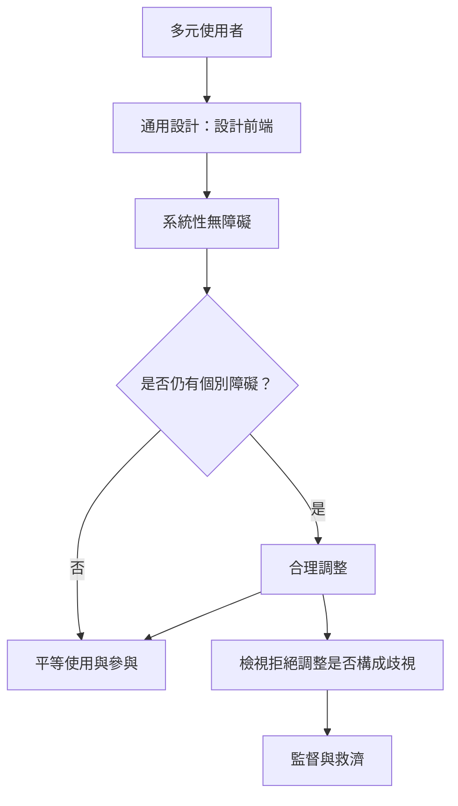

無障礙、通用設計與合理調整是互補概念。無障礙讓環境與服務預先可用；通用設計把多元使用者納入最初設計；合理調整則回應個別情境中仍未被涵蓋的需要。

## 關係圖

概念連結：[[note/無障礙是所有人事先可使用環境與服務的系統性條件|無障礙是所有人事先可使用環境與服務的系統性條件]]、[[note/合理調整讓平等原則回應個人具體情境|合理調整讓平等原則回應個人具體情境]]、[[note/通用設計讓多元差異成為設計起點而非例外|通用設計讓多元差異成為設計起點]]、[[note/實質平等必須處理不同群體承受的不同障礙|實質平等必須處理不同群體承受的不同障礙]]。

回到導讀：[[Convention_on_the_Rights_of_Persons_with_Disabilities|本書導讀]]
