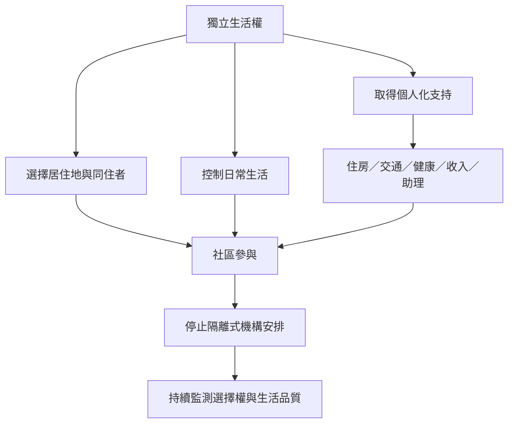

第 19 條的關鍵不是個人住在哪一種建築，而是本人有沒有選擇與控制生活的權力。去機構化必須與可負擔住房、個人助理、社區支持與一般服務的投資同步。

## 關係圖

概念連結：[[note/獨立生活的核心是本人能控制生活安排而不是獨居|獨立生活的核心是本人能控制生活安排而不是獨居]]、[[note/去機構化必須同時停止隔離並投資個人化社區支持|去機構化必須同時停止隔離並投資個人化社區支持]]、[[note/機構化可能以小型家屋或社區服務形式延續|機構化可能以小型家屋或社區服務形式延續]]、[[note/障礙者第一人稱證詞應被視為制度分析而非勵志素材|障礙者第一人稱證詞應被視為制度分析而非勵志素材]]。

回到導讀：[[Convention_on_the_Rights_of_Persons_with_Disabilities|本書導讀]]
