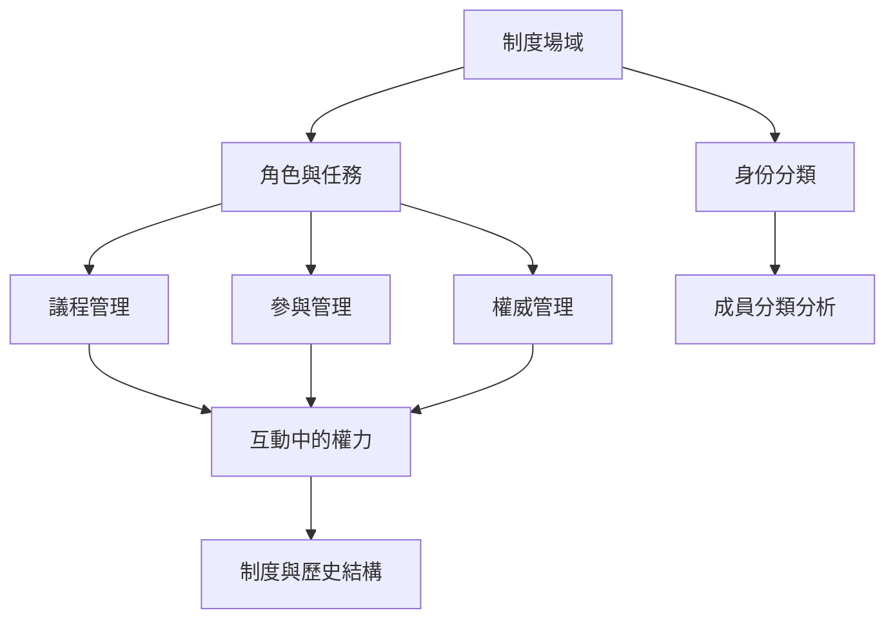

醫療、教室、職場與公共機構的談話，讓一般互動資源和制度角色相互作用。會話分析能描繪權威如何在回合中被實作；成員分類分析能顯示身份如何在互動中被召喚；批判延伸則需連接制度外部的權力結構。

**雙向連結**：[[制度互動把一般序列組織調整為專業任務]]、[[社會分類會在互動中被召喚協商與再製]]、[[權力既在回合中實作也受互動之外的制度結構影響]]、[[權威透過發言權與行動決策在互動中被實作]]、[[照護溝通需要同時分析議程參與與權力關係]]。
