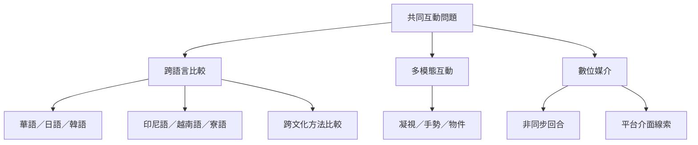

互動的基本問題可能在不同語言中反覆出現，但具體實作會因語法、語調、身體行動及媒介條件而不同。跨文化研究應先建立可比的行動環境，再比較互動方法；數位研究則需把平台的時間與介面功能納入分析。

**雙向連結**：[[跨語言比較應比較互動方法而不是民族性格]]、[[多模態互動把語言身體與物件放入同一分析單位]]、[[數位媒介重新安排回合的可見性與時間性]]、[[跨文化溝通應先描述互動方法再解釋文化脈絡]]。
