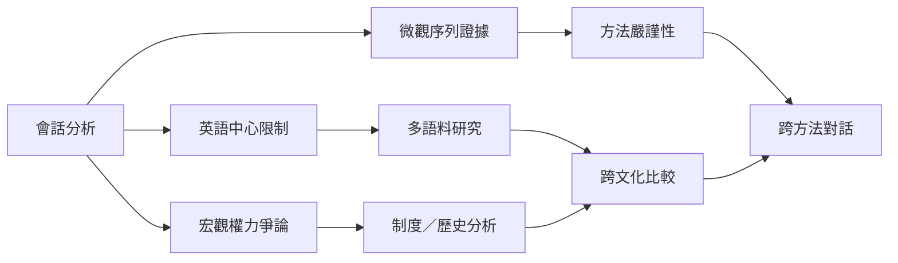

會話分析的強項是對互動細節提出嚴謹、可回查的描述；其風險則是過度侷限於局部回合，無法充分說明歷史、制度與宏觀權力。另一項挑戰是早期英語資料的比重，以及跨語言比較中翻譯與可比性問題。延伸研究應保留微觀證據，同時與文化、制度、數位媒介及其他方法對話。

**雙向連結**：[[會話分析與論述分析的差異涉及證據觀與研究典範]]、[[權力分析需要連接互動回合與制度背景]]、[[跨語言比較應比較互動方法而不是民族性格]]、[[數位媒介重新安排回合的可見性與時間性]]。
