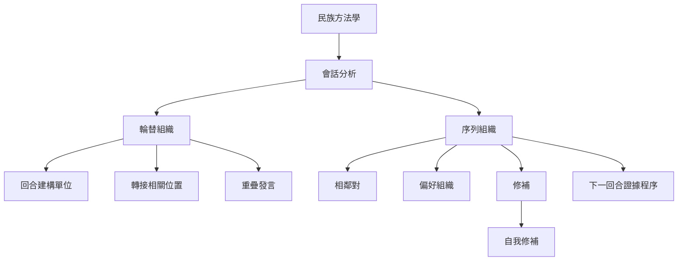

會話分析以互動中的社會行動為核心，從輪替與序列開始，理解參與者如何讓談話得以持續、如何處理理解問題，以及如何共同形成可辨認的行動。概念地圖由理論源流連到回合、序列、偏好與修補。

**雙向連結**：[[會話分析]]、[[民族方法學]]、[[輪替組織]]、[[回合建構單位]]、[[轉接相關位置]]、[[相鄰對]]、[[序列組織]]、[[修補]]、[[偏好組織]]、[[下一回合證據程序]]、[[Jefferson 轉寫]]。
