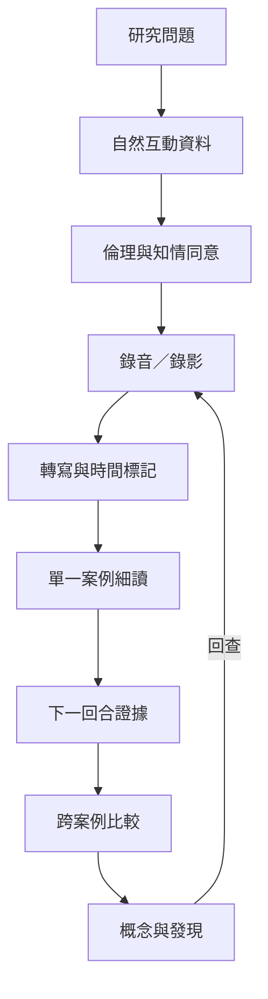

研究從研究問題與自然互動資料開始，經過倫理審查、錄音錄影、精細轉寫、案例分析與跨案例比較，逐步提出可檢驗的互動模式。研究者需要持續往返原始資料，避免把訪談陳述或分析者直覺當成參與者實際互動的替代品。

**雙向連結**：[[自然互動資料需要以倫理與情境敏感的方式蒐集]]、[[轉寫不是透明複製而是有目的的分析選擇]]、[[下一回合證據程序能約束研究者對意圖的推測]]、[[理解不是單向傳遞而是逐回合確認]]。
