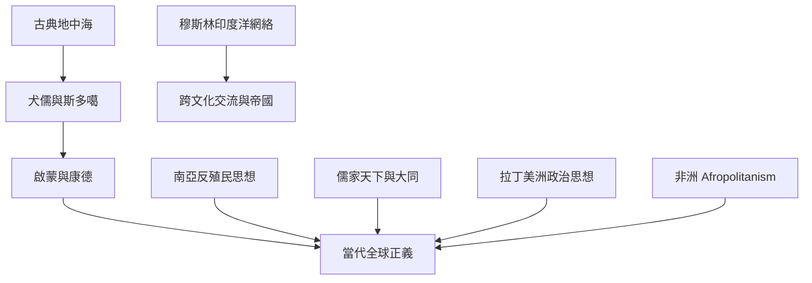

思想史不應只沿著「古希臘—啟蒙歐洲—當代全球化」單線發展，而應追蹤多地思想如何在商業、宗教、帝國、殖民、反殖民和移民網絡中彼此交會。閱讀時保留概念差異：歷史上的天下、大同或宗教普遍性，不必然等同現代平等世界公民權。

區域脈絡：[[斯多噶世界公民觀]]、[[天下]]、[[大同]]、[[南亞反殖民思想呈現世界主義與民族解放可以彼此交織]]、[[穆斯林社會的世界主義歷史由港口網絡與地方權力共同構成]]、[[儒家天下論述提供世界秩序想像但不能直接等同現代世界主義]]、[[拉丁美洲思想史顯示世界主義不只由歐洲理論定義]]、[[Afropolitanism]]。
