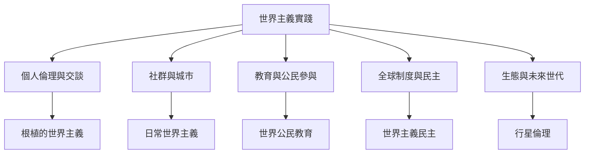

世界主義可以在多個尺度實踐：個人如何理解陌生人、社群如何建立跨文化關係、城市如何安排移民公共服務、教育如何培養全球公民、制度如何承擔跨境責任，以及人類如何面對行星尺度的生態危機。不同尺度需要不同方法，不能以個人善意取代制度改革，也不能以全球制度代替日常互惠。

實踐節點：[[根植的世界主義]]、[[日常世界主義]]、[[交談倫理]]、[[世界公民教育]]、[[世界主義民主]]、[[款待權]]、[[全球正義]]、[[行星倫理]]、[[共同但有區別的責任]]。
