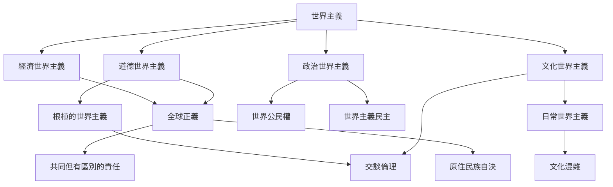

世界主義可從四個互相交疊的問題理解：誰被納入道德共同體、跨境權力如何治理、文化差異如何共存，以及全球制度如何分配責任。下圖整理主要概念；它不是唯一分類，而是一張可隨研究問題調整的工作地圖。

概念節點：[[世界主義]]、[[道德世界主義]]、[[政治世界主義]]、[[文化世界主義]]、[[經濟世界主義]]、[[根植的世界主義]]、[[世界公民]]、[[世界公民權]]、[[全球正義]]、[[世界主義民主]]、[[交談倫理]]、[[文化混雜]]、[[日常世界主義]]、[[共同但有區別的責任]]、[[原住民族自決]]、[[行星倫理]]。
