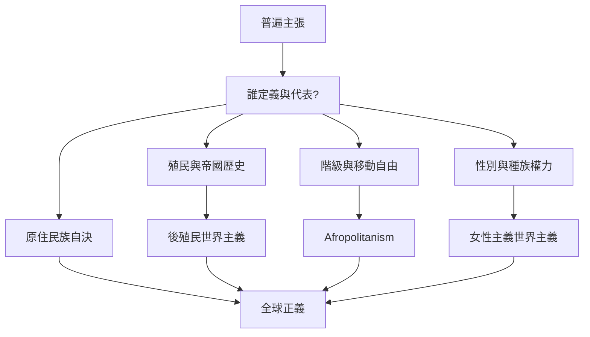

世界主義的普遍性必須持續回答：誰定義普遍、誰被代表、誰受益、誰承擔成本？殖民歷史、階級、種族、性別、原住民族自決與移民制度，讓我們看見跨境連結從來不是在平等條件下發生。批判世界主義的目標不是退回封閉民族主義，而是建立能由受影響者共同改寫的普遍規範。

核心概念：[[次屬世界主義]]、[[後殖民世界主義]]、[[原住民族自決]]、[[女性主義世界主義]]、[[Afropolitanism]]、[[文化混雜]]、[[全球正義]]、[[世界主義的殖民矛盾]]。
